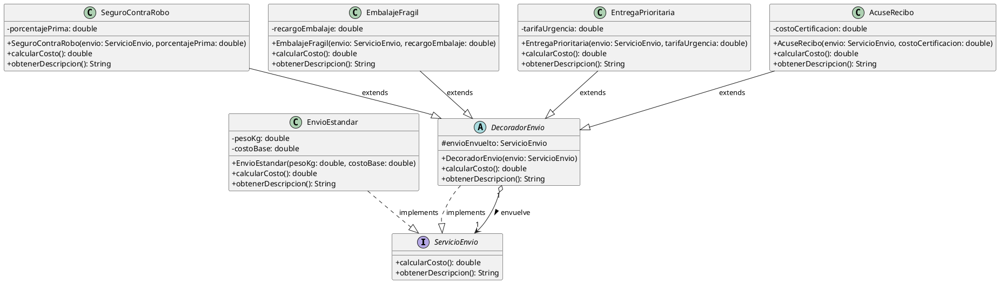

# Escenario 1: Servicios Adicionales en Correo Privado

## 1. Identificación del Patrón
- **Patrón:** Decorator
- **Categoría:** Estructural

## 2. Fundamentación Teórica
- **Problema detectado:** Explosión combinatoria de subclases mediante herencia estática. Al intentar modelar cada combinación posible de servicios opcionales (`EnvioConSeguro`, `EnvioConSeguroYFragil`, `EnvioPrioritarioConAcuse`, etc.) sobre un envío estándar, la jerarquía crece de forma exponencial ($2^n$ combinaciones) y el mantenimiento se vuelve inviable ante cualquier nuevo servicio adicional.
- **Solución con Decorator:** El patrón envuelve dinámicamente un objeto `Envio` dentro de objetos decoradores que implementan la misma interfaz (`ServicioEnvio`) y mantienen una referencia por agregación al componente envuelto. Cada decorador delega el cálculo base al envío que envuelve y suma su propio costo y descripción. Así se pueden apilar múltiples extras en tiempo de ejecución en cualquier orden o combinación, respetando el **Principio Abierto/Cerrado (OCP)** y favoreciendo la **composición sobre la herencia**.

## 3. Diagrama de Clases UML

