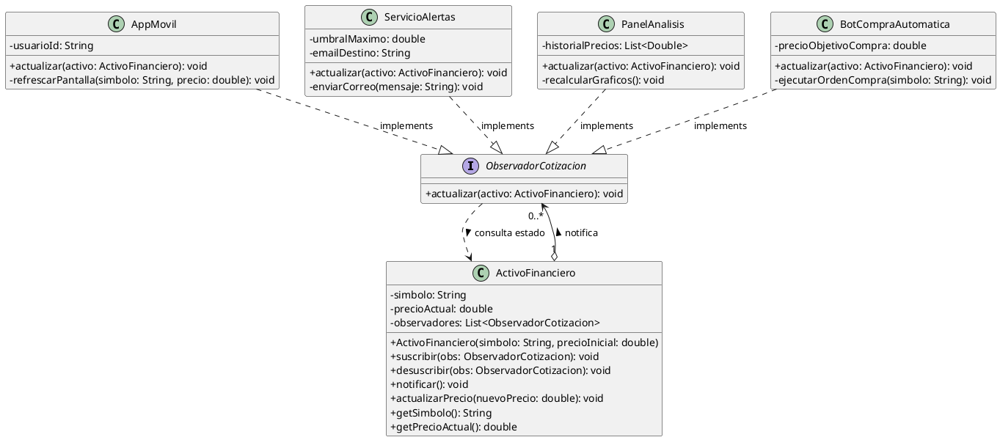

# Escenario 2: Monitor de Cotizaciones Financieras

## 1. Identificación del Patrón
- **Patrón:** Observer
- **Categoría:** De Comportamiento

## 2. Fundamentación Teórica
- **Problema detectado:** Acoplamiento fuerte y violación del Principio Abierto/Cerrado (OCP). Si `ActivoFinanciero` conociera e invocara directamente a la aplicación móvil, al servicio de alertas y al panel de análisis cada vez que cambia un precio, cualquier nuevo consumidor (como un bot de compra automática) obligaría a modificar el código del activo financiero. Además, no sería posible conectar o desconectar módulos dinámicamente en tiempo de ejecución.
- **Solución con Observer:** Define una dependencia uno-a-muchos entre el sujeto (`ActivoFinanciero`) y una interfaz común de observadores (`ObservadorCotizacion`). `ActivoFinanciero` mantiene una lista de suscriptores y expone métodos para suscribir, desuscribir y notificar cambios. Cuando la cotización se actualiza, el activo notifica a todos los observadores registrados sin conocer sus clases concretas, logrando bajo acoplamiento y extensibilidad dinámica.

## 3. Diagrama de Clases UML

