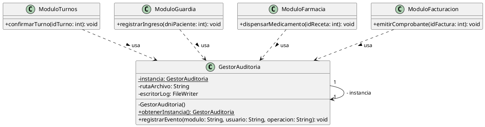

# Escenario 3: Registro Centralizado de Auditoría Hospitalaria

## 1. Identificación del Patrón
- **Patrón:** Singleton
- **Categoría:** Creacional

## 2. Fundamentación Teórica
- **Problema detectado:** Duplicación de recursos compartidos y ausencia de control centralizado de acceso. Al instanciar cada módulo (`Turnos`, `Guardia`, `Farmacia`, `Facturación`) su propio `GestorAuditoria`, múltiples objetos compiten simultáneamente por el mismo archivo `auditoria.log`, provocando condiciones de carrera, escrituras entrelazadas o fuera de orden y consumo redundante de memoria y descriptores de archivo.
- **Solución con Singleton:** Garantiza que `GestorAuditoria` posea una única instancia en toda la aplicación y provee un punto de acceso global estático (`obtenerInstancia()`). Al declarar el constructor como privado y almacenar la única instancia en un atributo estático, todos los módulos hospitalarios comparten el mismo gestor, el cual sincroniza la escritura secuencial sobre `auditoria.log`.

## 3. Diagrama de Clases UML

