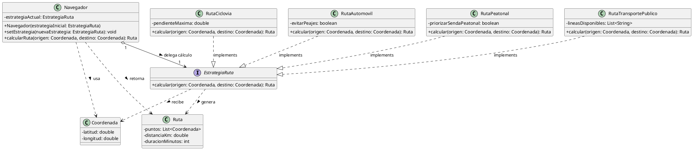

# Escenario 4: Cálculo de Rutas en Aplicación de Navegación

## 1. Identificación del Patrón
- **Patrón:** Strategy
- **Categoría:** De Comportamiento

## 2. Fundamentación Teórica
- **Problema detectado:** Rigidez por condicionales extensos (`if / else if`) concentrados en `Navegador.calcularRuta()`. Toda la lógica de cálculo para automóvil, peatón, ciclovía y transporte público convive en una única clase, generando baja cohesión y violando el **Principio Abierto/Cerrado (OCP)**: agregar un nuevo medio de transporte obliga a modificar y retestear la clase principal `Navegador`.
- **Solución con Strategy:** Encapsula cada algoritmo de cálculo de ruta en una clase independiente que implementa una interfaz común `EstrategiaRuta`. La clase `Navegador` (Contexto) mantiene una referencia a `EstrategiaRuta` y delega el cálculo en ella. El usuario puede intercambiar la estrategia dinámicamente en tiempo de ejecución mediante `setEstrategia(...)`, y sumar nuevos medios de transporte requiere únicamente crear una nueva clase que implemente `EstrategiaRuta`.

## 3. Diagrama de Clases UML

