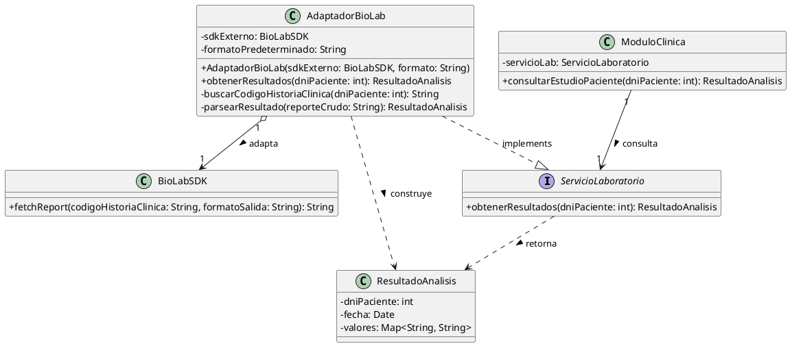

# Escenario 5: Integración con Equipamiento de Laboratorio Médico

## 1. Identificación del Patrón
- **Patrón:** Adapter
- **Categoría:** Estructural

## 2. Fundamentación Teórica
- **Problema detectado:** Incompatibilidad de interfaces entre el sistema existente de la clínica (`ServicioLaboratorio.obtenerResultados(int dniPaciente)`) y el SDK cerrado del nuevo analizador (`BioLabSDK.fetchReport(String codigoHistoriaClinica, String formatoSalida)`). No es posible modificar `BioLabSDK` porque es código cerrado de terceros, ni conviene alterar los módulos de la clínica ya que generaría alto acoplamiento e impacto en todo el sistema.
- **Solución con Adapter:** Se introduce una clase adaptadora (`AdaptadorBioLab`) que implementa la interfaz `ServicioLaboratorio` esperada por la clínica y envuelve por composición/agregación una instancia de `BioLabSDK`. Cuando un módulo invoca `obtenerResultados(dniPaciente)`, el adaptador traduce el DNI al `codigoHistoriaClinica` correspondiente, llama a `bioLabSDK.fetchReport(...)` con el formato adecuado y transforma la respuesta al modelo `ResultadoAnalisis` propio de la clínica, manteniendo desacoplados los módulos existentes y el SDK externo.

## 3. Diagrama de Clases UML

