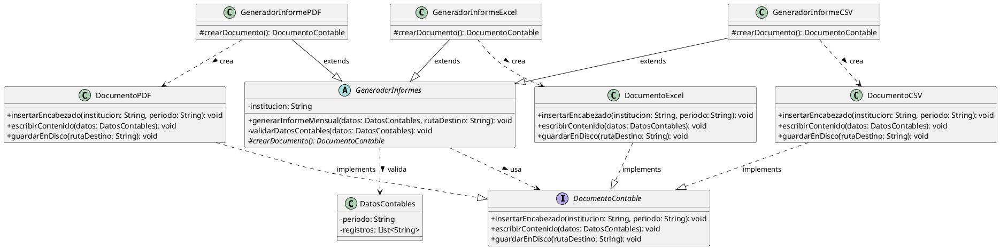

# Escenario 6: Módulo de Exportación de Documentos Contables

## 1. Identificación del Patrón
- **Patrón:** Factory Method
- **Categoría:** Creacional

## 2. Fundamentación Teórica
- **Problema detectado:** Acoplamiento fuerte hacia una implementación concreta y violación del Principio Abierto/Cerrado (OCP). `GeneradorInformes` instancia directamente `new DocumentoPDF()` dentro de su flujo general de exportación (validar datos, crear documento, insertar encabezado institucional y guardar en disco), impidiendo extender el sistema a Excel o CSV sin modificar la clase principal.
- **Solución con Factory Method:** Se declara un método fábrica abstracto `crearDocumento(): DocumentoContable` dentro de la clase abstracta `GeneradorInformes`, manteniendo en ella el flujo invariante de exportación (`generarInformeMensual()`). Cada subclase especializada (`GeneradorInformePDF`, `GeneradorInformeExcel`, `GeneradorInformeCSV`) implementa `crearDocumento()` para instanciar el tipo concreto de documento (`DocumentoPDF`, `DocumentoExcel`, `DocumentoCSV`), delegando la creación a las subclases sin alterar el flujo general.

## 3. Diagrama de Clases UML

